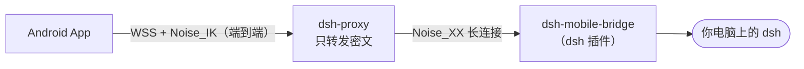
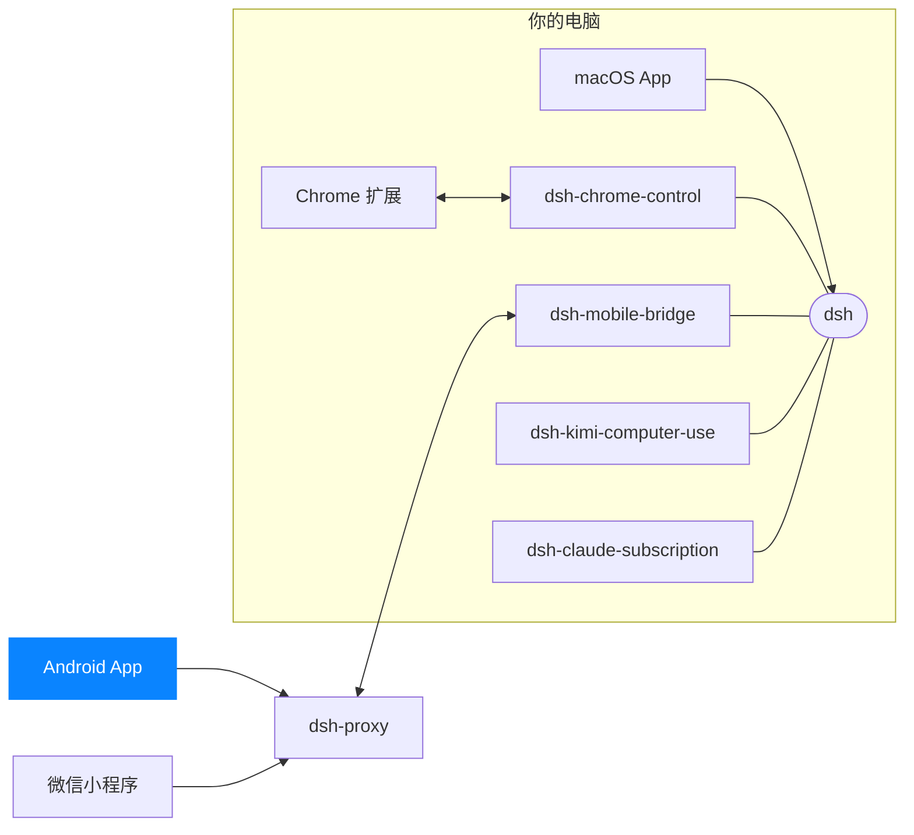

<p align="center">
  
</p>

<h1 align="center">DSH for Android</h1>

<p align="center">
  <b>口袋里的 DSH：离开电脑，任务也不会卡在审批上</b><br>
  看进度 · 批准请求 · 回答提问 · 追加指令 · 系统通知 —— 电脑不开端口，全程端到端加密
</p>

<p align="center">
  <a href="https://dshapp.github.io/download/#android"></a>
  
  
  
</p>

<p align="center">
  <a href="https://dshapp.github.io/products/android/">产品介绍</a> ·
  <a href="https://dshapp.github.io/docs/install-android/">安装说明</a> ·
  <a href="https://dshapp.github.io/docs/pairing/">配对与设备管理</a> ·
  <a href="https://dshapp.github.io/whatsnew/#android">更新日志</a>
</p>

<p align="center">
  
  &nbsp;&nbsp;
  
</p>

长任务跑到一半要你批准一个操作、回答一个问题，你却在会议室、在路上——任务就这么卡住了。
DSH for Android 让你在手机上接管**电脑上的同一个 DSH**：同一批会话、同一份文件，不是云端副本。

## 亮点

- **任务不再卡在审批上** —— 审批与提问直接在手机上处理，多道提问逐题作答，也能自定义答案。
- **第一时间知道结果** —— 任务有进展、完成、失败或等你回答都会推送通知；任务运行时后台保持连接，锁屏不中断。
- **不开端口、不做内网穿透** —— 电脑主动连到公网中转，手机经中转连回来；不需要公网 IP、路由器设置或 VPN。
- **端到端加密** —— 一次 Noise_IK 握手同时完成加密与双向认证，中转只转发密文，读不到内容、不落盘。
- **完整的客户端** —— 新建会话、发消息和附件、插话、编辑排队消息、看每轮改动与 diff、停止后台任务、会话内查找。
- **平板与横屏** —— 宽屏（≥600dp）下会话列表与详情左右并排，转屏时带着当前会话切换布局。
- **随时收回** —— 在电脑上吊销设备，它已有的连接立即断开；也可一键临时切断所有手机访问。

## 它是怎么连上的



| 组件 | 作用 |
| --- | --- |
| [dsh-mobile-bridge](https://github.com/dshapp/dsh-mobile-bridge) | 装在 dsh 里的插件，把 DSH 经加密隧道交给已配对的手机；不开端口、不写状态文件、不额外起进程 |
| [dsh-proxy](https://github.com/dshapp/dsh-proxy) | 唯一的公网组件，只读路由信息、转发密文；可以自己部署 |
| **Android App**（本仓库） | 手机上的 DSH 客户端 |

插件随 dsh 服务一起运行，**任何跑着 `dsh web` 的电脑都能用**，不限于 [Mac App](https://github.com/dshapp/dsh-macapp)。用 iPhone 或者不想装 App？试试微信小程序 [DSH Remote](https://github.com/dshapp/dsh-miniapp)，扫的是同一个二维码。

## 三步连上

1. **电脑上装插件**：[Mac App](https://github.com/dshapp/dsh-macapp) 已内置入口；命令行用户运行 `dsh plugin --profile web add dsh-mobile-bridge`。
2. **打开配对页**：Mac App 侧栏点「移动端访问」，或在浏览器打开 dsh web 的 `/mobileaccess`。
3. **用 App 扫码**，完成。配对码 5 分钟内有效、只能用一次；配对后 180 天内无需重新配对。

安装包从 [下载页](https://dshapp.github.io/download/#android) 获取（Android 8.0+，需要相机）。App 会在后台检查新版本，提示「立即更新 / 下次再说」。

## 从源码构建

需要 JDK 17 与 Android SDK 35。

```bash
./deploy.sh -r                # 构建 debug 包、安装到已连接设备并启动
./deploy.sh -l                # 同上，并跟随 logcat
./deploy.sh -h                # 全部选项（-c 先 clean、-s 指定设备、-v release）
./gradlew test                # 协议解码等 JVM 单测
./gradlew assembleRelease     # release 包（签名由 DSH_KEYSTORE_* 环境变量注入）
```

自测时可以传 `-PprobeSuffix=.probe` 装一份独立包名的实例，与日常使用的实例互不干扰。

| 路径（`app/src/main/java/ai/deepseek/dshphone/`） | 内容 |
| --- | --- |
| `net/` | Noise_IK 握手、WSS 隧道、多路复用流与 RPC |
| `state/` · `model/` | 会话、事件流与渲染模型 |
| `ui/` | Jetpack Compose 界面（Material 3） |
| `AgentExecutionService.kt` · `AgentNotifications.kt` | 任务运行时的前台服务与系统通知 |
| `AppUpdater.kt` | 自更新：读取站点 `latest.json`，下载校验后交给系统安装器 |

协议适配与设计记录在 [`docs/`](docs/)：`DSH-<版本>-ADAPTATION.md`（逐版跟进 dsh）、`IMAGE-PROTOCOL.md`、`FILE-PREVIEW-PROTOCOL.md`。

**发布**：push 到 `main` 后通知 [产品站](https://github.com/dshapp/dshapp.github.io) 构建签名 APK、发布 Release，并自动更新 [下载页](https://dshapp.github.io/download/#android) 与 [更新日志](https://dshapp.github.io/whatsnew/#android)。

<!-- dsh-family:start -->
## DSH App 家族

**DSH App** 是为 [DeepSeek Harness](https://github.com/deepseek-ai/deepseek-harness)（`dsh`）打造的一组客户端与插件。它们都接入你电脑上**同一个** dsh——会话、模型与插件处处互通，按需组合即可。下载与文档见 **[dshapp.github.io](https://dshapp.github.io/)**。



| | 项目 | 做什么 | 链接 |
| --- | --- | --- | --- |
| 客户端 | **macOS App**<br>`dsh-macapp` | 原生 SwiftUI 客户端，托管本机 dsh，一站式开启各个扩展 | [介绍](https://dshapp.github.io/products/macos/) · [源码](https://github.com/dshapp/dsh-macapp) |
|  | **Android App** ← 你在这里<br>`dsh-androidapp` | 口袋里的 DSH：审批、提问、通知，端到端加密连回电脑 | [介绍](https://dshapp.github.io/products/android/) |
|  | **微信小程序 DSH Remote**<br>`dsh-miniapp` | 免安装，iPhone / Android 的微信里扫码接管 DSH | [介绍](https://dshapp.github.io/products/miniapp/) · [源码](https://github.com/dshapp/dsh-miniapp) |
|  | **Chrome 扩展**<br>`dsh-chrome-extension` | 浏览器侧栏里的 DSH 客户端，也是浏览器控制的执行端 | [介绍](https://dshapp.github.io/products/chrome/) · [源码](https://github.com/dshapp/dsh-chrome-extension) |
| dsh 插件 | **浏览器控制**<br>`dsh-chrome-control` | 把你已登录的 Chrome 作为 `mcp__chrome__*` 工具交给 Agent | [介绍](https://dshapp.github.io/products/chrome/) · [源码](https://github.com/dshapp/dsh-chrome-control) |
|  | **移动端桥接**<br>`dsh-mobile-bridge` | 经 Noise 加密隧道把 dsh 交给已配对的手机，不开端口 | [介绍](https://dshapp.github.io/products/android/) · [源码](https://github.com/dshapp/dsh-mobile-bridge) |
|  | **电脑操作**<br>`dsh-kimi-computer-use` | 让 Agent 在后台操作没有 API 的 Mac 应用 | [介绍](https://dshapp.github.io/products/cu/) · [源码](https://github.com/dshapp/dsh-kimi-computer-use) |
|  | **Claude 订阅**<br>`dsh-claude-subscription` | 用 Claude Code 订阅在 DSH 里跑 Claude 模型，不用另买 API Key | [源码](https://github.com/dshapp/dsh-claude-subscription) |
| 基础设施 | **中转服务**<br>`dsh-proxy` | 手机远程唯一的公网组件：单端口、只转发密文、无状态 | [介绍](https://dshapp.github.io/docs/crypto/) · [源码](https://github.com/dshapp/dsh-proxy) |
|  | **产品站**<br>`dshapp.github.io` | 下载、文档与更新日志 | [介绍](https://dshapp.github.io/) · [源码](https://github.com/dshapp/dshapp.github.io) |
<!-- dsh-family:end -->
